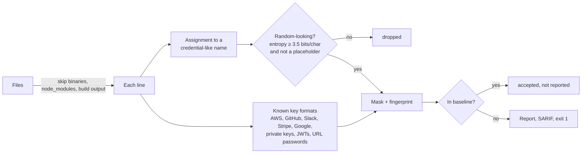

# secret-scanner

A command-line scanner that stops two common ways a codebase leaks: credentials committed to the repository, and dependencies pinned to versions with known security holes. It exits non-zero on new findings, so it can block a pull request.

No dependencies. Python 3.10+.

## How a file is scanned



Two detectors run on every line. Provider formats are precise patterns. The generic detector catches `api_token = "..."` style assignments, and keeps a match only if the value looks random. That entropy check is what stops it firing on `password = "changeme"` in documentation.

## What it guarantees, and the test behind each

| Behaviour | Test |
|---|---|
| Detects eight credential formats, plus high-entropy assignments | `test_known_provider_formats_are_detected`, `test_password_inside_a_connection_url` |
| Placeholders, repeated characters, commit hashes and `${VAR}` references are not flagged | `test_generic_assignment_needs_a_random_looking_value`, `test_similar_looking_strings_are_not_flagged` |
| Output never contains a full secret: reports, baseline and SARIF hold a masked preview and a hash | `test_report_never_contains_the_full_secret`, `test_baseline_hides_accepted_findings_and_stores_no_secrets`, `test_sarif_shape` |
| A baseline hides accepted findings; a new leak still fails the build | `test_baseline_hides_accepted_findings_and_stores_no_secrets`, `test_cli_exit_codes_gate_ci` |
| A finding keeps its identity when its line moves, so baselines survive edits | `test_fingerprint_is_stable_across_line_moves_but_differs_by_file` |
| Versions compare numerically (`2.10` is newer than `2.9`); affected range is inclusive of the first bad version and exclusive of the fix | `test_versions_compare_numerically_not_as_text`, `test_affected_range_is_introduced_inclusive_fixed_exclusive` |
| Unpinned dependencies are reported, since they cannot be checked | `test_requirements_parsing` |
| This repository passes its own scan | `test_this_repository_scans_clean`, and a CI step |

17 tests. CI runs them on Python 3.10 and 3.12, then scans the repository with the scanner.

## Demo

`python -m secretscan demo` builds a throwaway project in a temp directory and scans it. The credentials in it are random fakes assembled at run time. Actual output:

```
1. First scan of the project
HIGH   deploy.sh:1                        github-token                   ghp_************Qi
MEDIUM app/client.py:1                    generic-credential-assignment  f9K2************1N
HIGH   app/config.py:1                    aws-access-key-id              AKIA************LD
HIGH   app/config.py:2                    url-with-password              f9K2************1N
secrets: 4 new, 0 in baseline
VULN   PyYAML==5.3.1      CVE-2020-14343  fixed in 5.4: Arbitrary code execution when loading untrusted YAML with full_load or FullLoader
VULN   requests==2.25.1     CVE-2023-32681  fixed in 2.31.0: Proxy-Authorization header leaked to the destination server on HTTPS redirects
UNPIN  flask>=2.0
dependencies: 2 vulnerable, 1 unpinned
   exit code 1

2. Accept what exists today as the baseline
baseline written: 4 accepted finding(s)

3. Someone commits a new key; only the new one is reported
HIGH   app/payments.py:1                  stripe-live-key                sk_l************Hs
secrets: 1 new, 4 in baseline
   exit code 1
```

Not reported in step 1, by design: `password = "changeme"` (placeholder), the README's `your_password_here`, a line marked `# secretscan:ignore`, and a key inside `node_modules/`.

## Use

```bash
pip install -e ".[dev]"
python -m secretscan scan . --requirements requirements.txt
python -m secretscan scan . --baseline .secretscan-baseline.json --update-baseline   # adopt in an existing repo
python -m secretscan scan . --baseline .secretscan-baseline.json --sarif out.sarif   # in CI
```

As a GitHub Actions step, with findings shown in the Security tab:

```yaml
- run: python -m secretscan scan . --baseline .secretscan-baseline.json --sarif secretscan.sarif
- uses: github/codeql-action/upload-sarif@v3
  if: always()
  with:
    sarif_file: secretscan.sarif
```

## Layout

| File | Contents |
|---|---|
| `secretscan/secrets.py` | Rules, entropy, masking, fingerprints, directory walk |
| `secretscan/deps.py` | `requirements.txt` parsing, version comparison, advisory matching |
| `secretscan/report.py` | Baseline file and SARIF 2.1.0 output |
| `data/advisories.json` | Four real CVEs used as sample data |

## Limits

- It scans the files as they are now, not git history. A secret committed and later deleted is still in the history and still needs rotating.
- `data/advisories.json` is a four-entry sample, not a vulnerability database. Real use needs a feed such as OSV loaded into the same format.
- Only `requirements.txt` with `==` pins is checked. Lock files for other ecosystems and transitive dependencies are not.
- Pattern matching cannot tell a live key from a revoked one, and it misses secrets with no recognisable shape or name, such as a short password in an oddly named variable.
- Version comparison handles plain numeric versions; pre-release ordering and epochs from PEP 440 are not implemented.
- The upload-sarif snippet above is the standard usage but is not exercised by this repository's CI.
